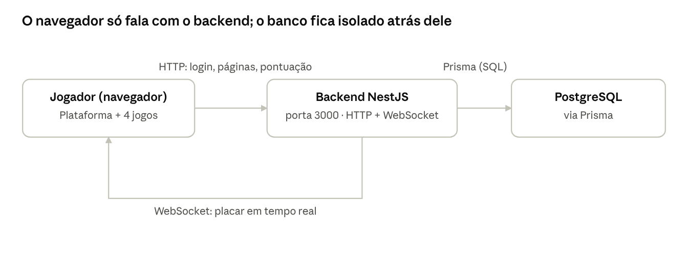

# Mundo SENAI Arcade — Estrutura do Projeto

O **Mundo SENAI Arcade** é uma plataforma web que reúne quatro mini-jogos feitos por turmas do SENAI (Humans vs IA, Tomb of the Mask, Limbo e Level Devil) num só lugar, com um sistema comum de nickname, pontuação e ranking.

Este documento explica como o projeto é organizado por dentro, para servir de roteiro quando os estudantes forem apresentar o trabalho: o que roda no servidor, o que roda no navegador, como os dados são guardados e como cada jogo se conecta ao placar geral.

## Arquitetura geral



O navegador nunca fala direto com o banco de dados: tudo passa pelo backend, que também avisa o dashboard em tempo real por WebSocket assim que uma pontuação nova chega.

## Backend (NestJS)

O backend é uma API em **NestJS** (TypeScript), organizada em módulos — cada pasta em `backend/src/` cuida de uma responsabilidade:

| Módulo | O que faz |
| --- | --- |
| `players` | Identifica o jogador pelo nickname (cria se for novo) e devolve os recordes dele em cada jogo |
| `games` | Lista os jogos disponíveis e o ranking (top 10) de cada um |
| `scores` | Recebe o resultado de uma partida (`POST /api/scores`) e grava no banco |
| `dashboard` | Monta os dados agregados do painel: rankings, resumo, partidas recentes |
| `events` | Gateway de WebSocket (Socket.IO) que avisa o dashboard em tempo real quando uma pontuação nova chega |
| `prisma` | Conexão com o banco de dados, compartilhada pelos outros módulos |

O backend também serve o próprio frontend como arquivos estáticos (pasta `frontend/`), então tudo roda a partir de um único endereço — não há um servidor separado para as páginas. A documentação interativa da API fica em `/api/docs` (Swagger).

## Banco de dados

O banco é **PostgreSQL**, acessado pelo backend através do **Prisma** (`backend/prisma/schema.prisma`). São três tabelas:

| Tabela | Principais campos | Para que serve |
| --- | --- | --- |
| `players` | id, nickname, nicknameNormalized (único) | Um registro por jogador; o nickname normalizado evita duplicar "Ana" e "ana " |
| `games` | id (ex.: `LIMBO`), name, description, active | Um registro fixo por jogo (cadastrado pelo `seed.ts`) |
| `game_scores` | id, playerId, gameId, score, duration, createdAt | Uma linha **por partida jogada** — não só a melhor |

Como cada partida vira uma linha nova em `game_scores`, o histórico completo fica guardado; o ranking exibido (top 10) é calculado pegando a **melhor pontuação de cada jogador** em cada jogo, na hora da consulta.

## Frontend (plataforma + jogos)

Tudo isso fica em `frontend/`, servido como arquivos estáticos pelo próprio backend:

- **`index.html`** — a plataforma: pede o nickname, lista os 4 jogos e mostra o recorde pessoal em cada um.
- **`dashboard.html`** e **`ranking.html`** — painel ao vivo (usado em telão/projetor) e ranking geral.
- **`games/<nome_do_jogo>/`** — uma pasta por jogo, com o código que cada turma escreveu (HTML, CSS, JS próprios). Cada jogo continua praticamente independente — só ganhou um pequeno pedaço de código para conversar com a plataforma.
- **`js/config.js`** — um único lugar com o endereço da API.
- **`js/arcade-sdk.js`** — sabe quem é o jogador atual e envia a pontuação final para o backend.
- **`js/game-shell.js`** (o `ArcadeShell`) — a peça nova mais importante: desenha a tela inicial padrão (Jogar / Recordes / Voltar), a tela de fim de jogo e o botão flutuante de sair, com a cor de cada jogo. É ele que todo jogo chama para aparecer na plataforma do jeito certo.
- **`css/game-shell.css`** — o visual dessa tela compartilhada.

## Como um jogo se conecta à plataforma

Da identificação do jogador até o placar aparecer no dashboard, o caminho é sempre o mesmo, em qualquer um dos 4 jogos:

1. Na plataforma (`index.html`), o jogador digita o nickname — isso cria (ou recupera) o registro dele em `players` e fica guardado no navegador (sessionStorage).
2. Ele clica em "Jogar agora" num card e é levado para `games/<jogo>/index.html`.
3. O jogo chama `ArcadeShell.init({ gameId, gameName, accentColor, onPlay, getScore })`, que mostra a tela inicial padrão com o nome do jogador já preenchido.
4. Ao clicar em "Jogar", a tela some e o código próprio do jogo (escrito por cada turma) assume — aqui cada jogo é totalmente diferente.
5. Quando a partida acaba (ou o jogador clica em "Sair"), o jogo chama `ArcadeShell.gameOver(pontos)` ou `reportScore(...)`, que envia `{ gameId, playerId, score, duration }` para `POST /api/scores`.
6. O backend grava a pontuação em `game_scores` e avisa o dashboard na hora, via WebSocket.
7. O jogador vê os recordes (top 10, vindos direto do backend) e pode voltar à plataforma para escolher outro jogo.

## Como rodar o projeto localmente

```
# 1) Banco de dados (uma vez só)
docker compose up -d postgres

# 2) Backend
cd backend
npm install
npx prisma generate
npx prisma migrate deploy
npx prisma db seed      # cria os 4 jogos e alguns jogadores de exemplo
npm run start:dev
```

Com isso, o site inteiro (plataforma + jogos + dashboard) fica em `http://localhost:3000`.

**Para outros computadores acessarem pela rede** (ex.: alunos conectados no mesmo cabo/roteador que o computador do professor), só precisa liberar **uma porta** no firewall do Windows: a **3000/TCP** (a mesma configurada em `PORT` no arquivo `.env` do backend — troque ali se precisar usar outra). O banco de dados (porta 5432) é usado só internamente pelo próprio backend e não precisa ficar aberto para a rede.

No computador que vai rodar o backend (o do professor), com PowerShell como administrador:

```powershell
New-NetFirewallRule -DisplayName "SENAI Arcade" -Direction Inbound -Protocol TCP -LocalPort 3000 -Action Allow -Profile Any
```

Depois, descubra o IP dessa máquina na rede (`ipconfig`, o "Endereço IPv4") e os outros computadores acessam por `http://<esse-IP>:3000` em vez de `localhost`. Se mesmo assim não funcionar, vale conferir se a rede está marcada como **Privada** nas configurações do Windows — em redes **Públicas** o firewall bloqueia conexões de entrada por padrão, mesmo com a regra acima.

## Guia para a apresentação

Uma ordem simples para a apresentação, dividindo entre os grupos:

1. **Abertura (plataforma)** — mostrar o `index.html`: digitar um nickname, mostrar os 4 jogos e os recordes de cada um.
2. **Cada turma apresenta o seu jogo** — 2–3 minutos cada: a mecânica do jogo, uma fase jogada ao vivo, e o que tiveram que ajustar para encaixar na plataforma (tela inicial, enviar a pontuação).
3. **Dashboard ao vivo** — abrir `dashboard.html` num segundo monitor/telão enquanto alguém joga: mostrar a pontuação aparecendo na hora, sem atualizar a página (WebSocket).
4. **Por baixo dos panos** — explicar rapidamente a arquitetura (diagrama acima): o navegador fala com o backend por HTTP, o backend guarda tudo no PostgreSQL e avisa o dashboard por WebSocket.
5. **Perguntas** — pontos fortes para destacar: cada jogo continuou com o código original da turma; a integração foi feita com uma camada pequena e compartilhada (`ArcadeShell`), em vez de reescrever cada jogo do zero.
